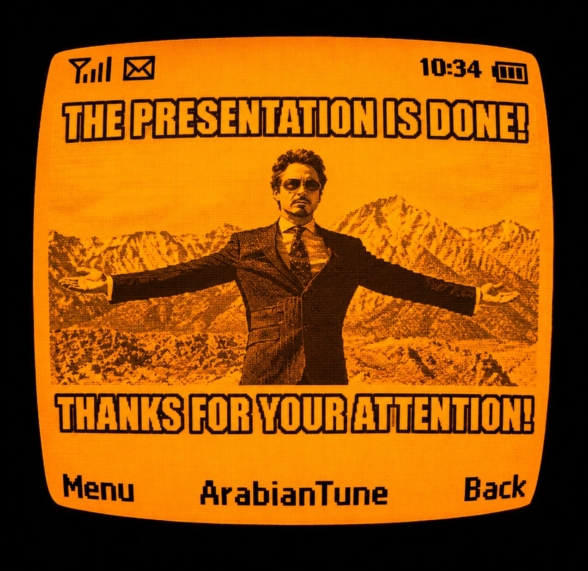

<!--
  GITHUB PROFILE README
  Style: Dark editorial / monochrome / Gen Z

  CHECKLIST BEFORE PUSHING:
  1. assets/header.jpeg  -> must exist (exact name, GitHub is case-sensitive)
  2. assets/Meme.webp    -> must exist (exact name, capital M)
  3. Repo name must be exactly your username: shsajjad098-oss
-->

<div align="center">


# SAJJAD HOSSAIN

### `code. create. break. debug. repeat.`

**Web Developer · Digital Marketer · Funnel & Automation Builder**

*Building things for the internet. Occasionally arguing with it.*

<br/>

<a href="https://sajjadxyz.vercel.app/"></a>
<a href="https://github.com/shsajjad098-oss"></a>
<a href="mailto:gssajjad098@gmail.com"></a>
<a href="https://wa.me/8801610211332"></a>

<br/><br/>


</div>

---

## `01 / THE HUMAN BEHIND THE SCREEN`

Yo, I'm Sajjad. I build websites, explore code, and work on digital marketing.

I like clean interfaces, functional backends, and marketing that actually makes sense.

```js
const sajjad = {
  role: "Web Developer + Digital Marketer",
  buildsFor: ["Coaches", "Restaurants"],
  buildsWith: ["Websites", "Sales funnels", "Automation systems"],
  fuel: "caffeine + stubbornness",
  status: "building, learning, breaking, fixing",
};

console.log("Let's build something that actually works.");
```

- **Frontend:** Making pixels behave.
- **Backend:** Making things work when nobody's looking.
- **Digital Marketing:** Getting the right eyes on the right things.
- **SEO:** Helping websites get discovered without begging the algorithm.

Currently building, learning, experimenting, and occasionally questioning every life decision after a single error message.

> "It works on my machine" is not a deployment strategy.

## `02 / WHAT I'M INTO`

<div align="center">

| FIELD | CURRENT VIBE |
|:---|:---|
| `CODING` | Turning caffeine and logic into functioning things |
| `FRONTEND` | Pixels, layouts, interactions, and tiny details |
| `BACKEND` | The invisible stuff holding everything together |
| `DIGITAL MARKETING` | Strategy, visibility, and actual business growth |
| `SEO` | Making Google aware that we exist |
| `WEB DESIGN` | Clean interfaces > unnecessary visual chaos |

</div>

## `03 / THE TOOLBOX`

**Languages & Web Development**

<!-- Customize this list to match the technologies you actually use. -->
<p align="left">
  
</p>

**Other Interests**

`Frontend` · `Backend` · `Website Development` · `SEO` · `Shopify SEO` · `Local SEO` · `Digital Marketing`

Learning is part of the job. Pretending to know everything is a full-time job I didn't apply for.

<!-- Add your verified backend technologies and other tools to the icon list when ready. -->

## `04 / SELECTED WORK`

**[Personal Portfolio](https://sajjadxyz.vercel.app/)**

A corner of the internet where my work, ideas, and experiments live.

<!--
  Add concept projects here when ready, for example:

  **[Elevate Lab (Concept Project for Coaches)](LIVE_DEMO_URL)**
  High-converting website + funnel + automation concept for a coaching brand.

  **[Ember & Oak (Concept Project for Restaurants)](LIVE_DEMO_URL)**
  Dark, cinematic restaurant website with menu and reservation flow.
-->

More projects coming as I ship them. The README is not a fictional cinematic universe.

## `05 / GITHUB ACTIVITY`

<div align="center">


<br/>

<sub>Contribution graph is generated live. Empty squares are just future commits waiting to happen.</sub>

</div>

<!--
  OPTIONAL: GitHub stats cards (self-hosted so they never hit the public rate limit)

  The public github-readme-stats.vercel.app server is often overloaded,
  which is why the old stats images did not load.

  To fix it permanently:
  1. Fork https://github.com/anuraghazra/github-readme-stats
  2. Import the fork into Vercel
  3. Add an environment variable PAT_1 with a GitHub personal access token
  4. Replace YOUR-DEPLOYMENT below with your Vercel domain, then uncomment

<div align="center">


</div>
-->

## `06 / OUTSIDE THE TERMINAL`

Things I appreciate:

- Websites that load fast.
- Designs that know when to shut up.
- Code that makes sense the next morning.
- Marketing backed by strategy, not just vibes.
- Bugs that come with reproducible steps. Rare species.

## `07 / THE FINE PRINT`

<div align="center">

*Not a 10x developer. Just a developer who keeps showing up.*

**Built with curiosity. Debugged with questionable language.**

<br/>


<br/><br/>



</div>
